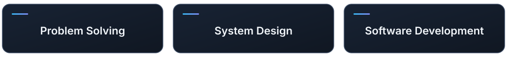

<h1>Kitisak Phetchaiwong</h1>

Interested in how things work, how different parts fit together, and how to turn complex problems into practical solutions.

---

## Engineering Approach

I'm interested in problem-solving, system design, and software development. I enjoy breaking down challenges, exploring different approaches, and understanding the constraints before choosing a solution.

> **An example of the questions I like exploring:** How can three cameras observe the same area reliably? Solving that involves more than adding cameras—it means thinking about placement, field of view, overlap, calibration, and how their data fits together.

I apply that same mindset to software: **clear architecture, maintainable components, reliable data flow, and testable behavior.** The goal is not just to make something work, but to understand *why* it works and how it can be improved.

## Tools & Technologies

### Languages

<table>
  <tr>
    <td align="center" width="112"> Python</td>
    <td align="center" width="112"> C++</td>
    <td align="center" width="112"> SQL</td>
  </tr>
</table>

### Development Tools

<table>
  <tr>
    <td align="center" width="112"> Visual Studio</td>
    <td align="center" width="112"> VS Code</td>
    <td align="center" width="112"> Git</td>
    <td align="center" width="112"> GitHub</td>
  </tr>
</table>

### Libraries & Platforms

<table>
  <tr>
    <td align="center" width="112"> OpenCV</td>
    <td align="center" width="112"> PyTorch</td>
    <td align="center" width="112"> NumPy</td>
    <td align="center" width="112"> PySide6</td>
    <td align="center" width="112"> Linux</td>
    <td align="center" width="112"> TensorRT</td>
  </tr>
</table>

## Selected Projects

| Project | Engineering focus |
| --- | --- |
| **[Femto 1.0 — Edge AI Waste Classification](https://github.com/kitisakphengthar13-stack/femto-1.0-edge-ai-waste-classification)** | Integrating perception, decision logic, and physical hardware control into one system. |
| **[Anomaly Inspection Desktop App](https://github.com/kitisakphengthar13-stack/anomaly-inspection-desktop-app)** | Designing a desktop workflow with separate inspection logic, user interface, and command-line tools. |
| **[Edge Model Inspector](https://github.com/kitisakphengthar13-stack/edge-model-inspector)** | Inspecting model artifacts and evaluating deployment options before committing to an implementation. |
